# contribution-sky

my github contribution graph as a night sky. every day i committed is a star, and a satellite sweeps across and tracks them, like [satellite-detector](https://github.com/valerie-ekeigwe/satellite-detector) does with real footage.

a github action redraws it every night from live data and publishes it to the `output` branch.



run it locally with fake data:

```bash
python sky.py --demo sky.svg
```
